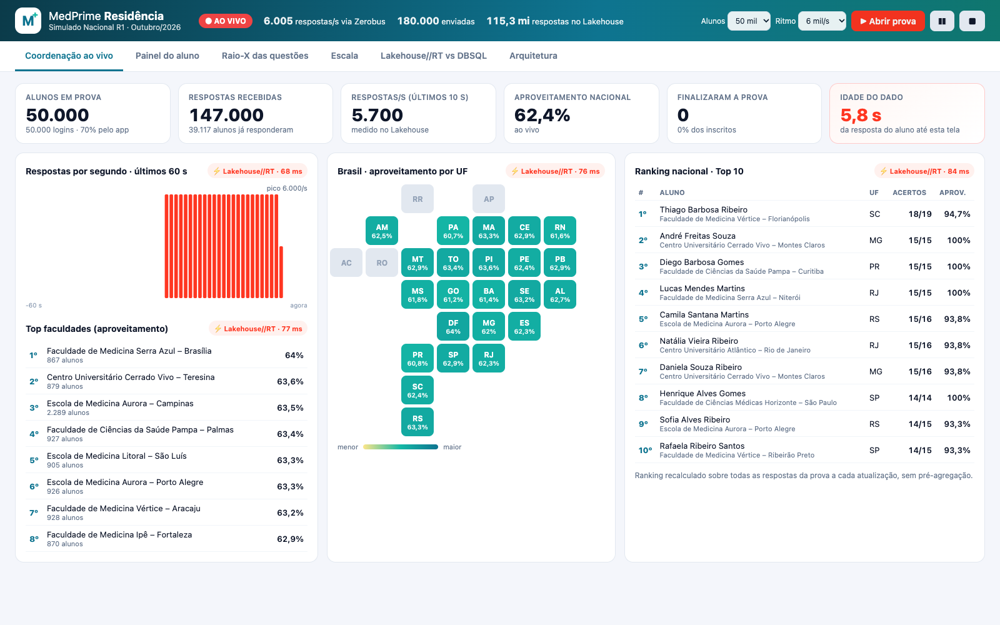
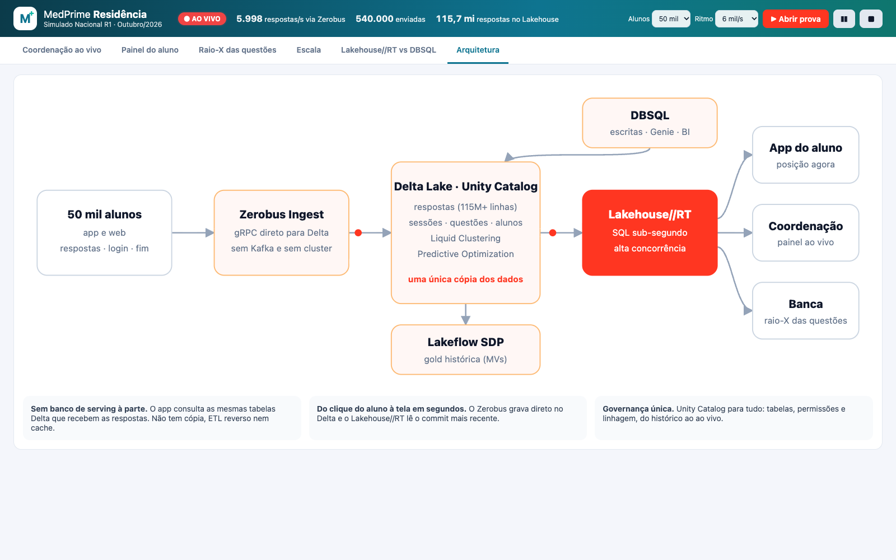

# Demo Zerobus + Lakehouse//RT · MedPrime Residência

Demo ao vivo de **ingestão em tempo real com Zerobus** e **serving sub-segundo com Lakehouse//RT**, no contexto de
educação médica: **50 mil alunos de residência fazendo um simulado nacional ao mesmo tempo**.

- As respostas dos alunos chegam pelo **Zerobus** direto em tabelas Delta do Unity Catalog. Não tem Kafka nem cluster.
- O **Lakehouse//RT** serve todas as telas do app (ranking nacional, painel do aluno, raio-X das questões) direto
  sobre as mesmas tabelas: 115M+ respostas históricas mais as que chegam ao vivo.
- Uma cópia só dos dados e uma governança só (Unity Catalog), sem banco de serving à parte.

> "MedPrime Residência" é uma marca **fictícia**. Todos os dados são **sintéticos** (PT-BR).



---

## Pré-requisitos

### Workspace
| Requisito | Detalhe |
|---|---|
| **Nuvem e região** | **AWS ou Azure**, numa região com **Zerobus Ingest** *e* **Lakehouse//RT** disponíveis. Zerobus, por exemplo: AWS `us-east-1`, `us-east-2`, `us-west-2`, `eu-central-1`, `eu-west-1`, `ap-southeast-1`, `ap-southeast-2`, `ap-northeast-1`, `ca-central-1`; Azure `eastus`, `eastus2`, `westus`, `centralus`, `northcentralus`, `canadacentral`, `westeurope`, `northeurope`, `swedencentral`, `australiaeast`, `southeastasia`. Confira as listas atuais em [Zerobus](https://docs.databricks.com/ingestion/zerobus-overview) e [Lakehouse//RT](https://docs.databricks.com/aws/en/compute/sql-warehouse/real-time). |
| **Unity Catalog** | Workspace com metastore UC. O catálogo de destino precisa usar **managed storage**, porque o Zerobus só escreve em tabelas *managed*. |
| **Serverless** | Serverless habilitado para **SQL warehouses**, **Jobs/notebooks**, **Lakeflow SDP (pipelines)** e **Databricks Apps**. |
| **Preview Lakehouse//RT** | Beta. Um admin do workspace habilita em **Settings → Previews → "Lakehouse RT"**; em alguns workspaces é preciso pedir ao account team.  |
| **Zerobus Ingest** | Disponível na região (GA). A cobrança vai no SKU de Jobs Serverless. Nenhuma configuração extra: o app usa o próprio service principal. |
| **Predictive Optimization** | Recomendado no catálogo/schema (mantém Liquid Clustering e VACUUM das tabelas). |

### Warehouses (criar antes do deploy)
O bundle **não cria** os warehouses: ele os encontra **pelo nome** (`lookup`).

| Nome padrão | Tipo | Uso |
|---|---|---|
| `lakehouse-rt` | **Real-Time** (Compute → SQL Warehouses → Create → tipo *Real-Time*), tamanho Small | Todas as leituras do app |
| `Serverless Starter Warehouse` | **Serverless** (Pro), Small | Escritas da demo (anulação, rodadas, limpeza) e lado "DBSQL" do comparativo. O RT é **somente leitura** |

> ⚠️ **Os nomes importam.** Se o warehouse Real-Time não se chamar exatamente `lakehouse-rt`, o `validate` falha com
> `failed to resolve warehouse: lakehouse-rt … does not exist`. Nesse caso, **crie o warehouse com esse nome** ou passe o ID
> em **todos** os comandos (`validate`, `deploy` e `run`):
> `--var rt_warehouse_id=<id>` (e `--var dbsql_warehouse_id=<id>` se o DBSQL tiver outro nome).
> O ID aparece em **Compute → SQL Warehouses → \<warehouse\> → Connection details** (final do *HTTP path*) ou em
> `databricks warehouses list -p <profile>`.

### Permissões de quem faz o deploy
- `USE CATALOG` e `CREATE SCHEMA` no catálogo de destino. O job de setup cria o schema e as tabelas.
- Permissão para **conceder** privilégios no catálogo/schema (dono ou `MANAGE`): o job concede acesso ao service principal do app.
- `CAN_USE` nos dois warehouses, mais permissão para criar **Apps**, **Jobs** e **Pipelines**.

### Máquina local
- **Databricks CLI** recente (testado com **v1.18.0**; precisa suportar `lookup` de warehouse e `config` de apps), autenticado: `databricks auth login --host <url> -p <profile>`.
- Opcional, para os testes em `scripts/`: Python 3.10+ com `playwright` (usa o Chrome instalado) e `databricks-sql-connector[kernel]`.

---

## Deploy em qualquer workspace

```bash
git clone <este-repo> && cd Demo-Zerobus-LakehouseRT

# 1. valida (resolve os warehouses pelo nome)
databricks bundle validate --strict -p <profile> --var catalog=<seu_catalogo>

# 2. cria app, pipeline e job
databricks bundle deploy -p <profile> --var catalog=<seu_catalogo>

# 3. dados + gold + grants (~4–5 min na 1ª vez; idempotente depois)
databricks bundle run medprime_setup -p <profile> --var catalog=<seu_catalogo>

# 4. sobe o app
databricks bundle run medprime_rt -p <profile> --var catalog=<seu_catalogo>
```

Variáveis (`--var nome=valor`):

| Variável | Padrão | Descrição |
|---|---|---|
| `catalog` | **obrigatória** | Catálogo UC de destino |
| `schema` | `rt_simulado` | Schema da demo (criado pelo setup) |
| `app_name` | `medprime-rt-simulado` | Nome do app (único no workspace) |
| `rt_warehouse_id` | lookup `lakehouse-rt` | Warehouse Real-Time |
| `dbsql_warehouse_id` | lookup `Serverless Starter Warehouse` | Warehouse DBSQL |

Para recriar todos os dados do zero: `databricks bundle run medprime_setup --params recriar=true ...`

**Alternativa: um target local.** Copie `databricks.local.yml.example` para `databricks.local.yml` (ignorado pelo git),
preencha host e catálogo e use `-t meu_ambiente` em vez de repetir `--var catalog=...`.

### O que o bundle cria

| Recurso | Nome | Descrição |
|---|---|---|
| Job | `medprime-setup-<schema>` | `dados` → `gold` → `grants_app` (serverless) |
| Pipeline (SDP) | `medprime-rt-gold-<schema>` | MVs `desempenho_aluno`, `desempenho_faculdade`, `estatisticas_questoes` |
| App | `<app_name>` | FastAPI + HTML/JS (sem CDN), com o simulador Zerobus embutido |
| Schema/tabelas | `<catalog>.<schema>` | `respostas`, `sessoes` (alvos do Zerobus), `alunos`, `faculdades`, `simulados`, `questoes`, `rodadas`, `anulacoes` |

**Sem segredos para gerenciar:** o app usa o **service principal que o Databricks Apps cria para ele**. Com ele o app
consulta o RT, escreve via DBSQL e ingere via Zerobus. O job `grants_app` concede ao SP: `USE CATALOG`, `USE SCHEMA`
e `SELECT` no schema, mais `SELECT, MODIFY` **explícitos** em `respostas`, `sessoes`, `anulacoes` e `rodadas`. O Zerobus
exige grant explícito na tabela. O endpoint do Zerobus (`<workspace-id>.zerobus.<região>.<domínio>`) é descoberto
em tempo de execução; para forçar outro, defina `ZEROBUS_ENDPOINT` no app.

---

## Arquitetura

```
Simulador (no app) ──Zerobus gRPC──► Delta/UC: respostas, sessoes ──► Lakehouse//RT ──► App (6 telas)
                                          │                                ▲
                                          └► Lakeflow SDP (gold histórica) ─┘
App ──(anulação / rodadas / limpeza)──► DBSQL Serverless ──► Delta/UC
```



## Telas
| Aba | O que mostra |
|---|---|
| **Coordenação ao vivo** | Alunos em prova, respostas/s, aproveitamento por UF, top 10 e top faculdades, idade do dado |
| **Painel do aluno** | "Você está em Nº de 50.000", posição na faculdade, desempenho por área, evolução em 24 simulados |
| **Raio-X das questões** | % de acerto por questão. A **Q47 tem gabarito errado de propósito** e fica ⚠; anular recalcula o ranking |
| **Escala** | N usuários consultando em paralelo; mostra o ponta a ponta e o tempo **dentro do motor RT** (query history) |
| **Lakehouse//RT vs DBSQL** | Mesma consulta nos dois warehouses |
| **Arquitetura** | Diagrama animado |

## Operação
- **▶ Abrir prova:** cria uma rodada nova e começa a ingestão (50 mil alunos, de 1 a 10 mil respostas/s).
- **❚❚ Pausar:** congela a prova sem apagar nada; clique de novo para continuar.
- **■ Encerrar:** pede confirmação, para o simulador, **espera o Zerobus materializar tudo** e **apaga os dados ao vivo**
  (`respostas`/`sessoes` com `rodada > 0` e `anulacoes`). Mantém o histórico (rodada 0), as dimensões, a gold e a tabela `rodadas`,
  para que a numeração continue crescente (o Zerobus é *at-least-once*).
- **Custo:** o ■ **não** desliga o app. Depois da demo: `databricks apps stop <app_name> -p <profile>`.
  Os warehouses param sozinhos pelo auto-stop, mas uma aba do app aberta continua consultando o RT a cada 10 s.

Roteiro completo, com falas e screenshots: [`docs/roteiro.html`](docs/roteiro.html).

## Números medidos (Small/Small, AWS us-east-1, 17/10/2026)
| Métrica | Valor |
|---|---|
| Ingestão Zerobus | ~6 mil respostas/s sustentadas pelo app (~15 mil/s num stream isolado) |
| Consultas do painel (no app) | 50–180 ms |
| Idade do dado | ~4–8 s: o Zerobus materializa no Delta em lotes de ~5 s |
| Ranking de 50 mil após anulação | ~70–260 ms |
| RT vs DBSQL (agregação do ranking) | ~220–300 ms × ~3,5–4,5 s (~15×) |
| Escala, 25 usuários | ponta a ponta p50 ~95 ms, p95 ~170 ms; no motor RT p50 ~50 ms, p95 ~85 ms |

## Limitações conhecidas (Beta)
- **Throughput ponta a ponta de ~140–250 consultas/s** neste ambiente. O limite aparece com qualquer cliente
  (Statement Execution API ou `databricks-sql-connector` com `use_kernel=True`) e também com o warehouse em Medium,
  então está na camada da API, não no motor. Por isso a tela de escala vai até 100 usuários.
- Um warehouse Real-Time tem **1 cluster**: `max_num_clusters` é ignorado.
- O RT só aceita a **Statement Execution API**, e a resposta precisa de `format=JSON_ARRAY` + `disposition=INLINE` explícitos
  (o padrão é Arrow). Ele é somente leitura e não suporta Genie, AI Functions, Python UDFs nem ABAC.
- Um registro recém-confirmado (*ack*) pelo Zerobus leva alguns segundos para aparecer no Delta.

## Estrutura
```
databricks.yml               # variáveis, lookups de warehouse, target genérico
databricks.local.yml.example # modelo de target local (copie para databricks.local.yml)
resources/                   # app, pipeline, job (um recurso por arquivo)
src/app/                     # FastAPI + simulador Zerobus + frontend estático
src/pipeline/gold.sql        # Lakeflow SDP (MVs)
src/setup/                   # notebooks do job de setup + SQL parametrizado
scripts/teste_visual.py      # teste E2E com Playwright (todas as abas, anulação, escala, ■)
scripts/bench_kernel.py      # benchmark de concorrência com o conector use_kernel
docs/                        # roteiro.html e screenshots
```

## Teste
```bash
databricks auth token -p <profile> -o json | python3 -c "import json,sys;print(json.load(sys.stdin)['access_token'])" > /tmp/apptok
python scripts/teste_visual.py https://<app-url> /tmp/shots
```
O teste abre a prova, percorre todas as abas, anula a Q47, roda a escala e o comparativo, encerra com limpeza e
reporta erros de console/HTTP.
